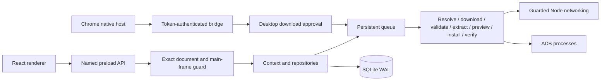

# Architecture audit
Baseline: 102fa70375eca04579b72fc8424516712b1d3143, Praashon/adb-install-script-v2. Reviewed 2026-10-25.

| Area | Actual implementation | Limits |
| --- | --- | --- |
| electron/main.ts | Single instance, context/bootstrap, window/events, extension server, shutdown | Main owns substantial filesystem/network work |
| preload / IPC | Named contextBridge methods; main repositories/native pickers/device tools | Broad surface; complete runtime payload schemas remain open |
| src | React 19, HashRouter, Zustand, Tailwind bench theme | Large renderer chunk; existing identity preserved |
| core/database | Drizzle over SQLite WAL; foreign keys; 5s busy timeout; additive migrations | No numbered migration ledger or comprehensive historical migration fixtures |
| core/job-manager | Persistent job/context steps, retries, concurrency, pause/cancel/recovery | Resume re-enters steps, not byte-range download or mid-install continuation |
| source-engine / sources/plugins | Versioned JSON manifests/rules, Cheerio, detection/import/export | Plugins are data; wrapper is not an OS sandbox |
| security-engine | Adapter policy, frozen data access, new Node network policy | Regex complexity and per-channel schemas need further work |
| download-engine | Direct/HTML/browser/redirect strategies, streaming, hash verification | Computed hash alone is identity, not publisher authenticity |
| apk-engine | Detection, validation, bundles, AXML, fingerprinting/review | Bounded but synchronous ZIP work remains in main |
| adb-engine | execFile/spawn argv, installs/OBB/packages/permissions/logcat/media/scrcpy | Remote adb shell reparses arguments; local argv alone is insufficient |
| browser-engine | Locally installed Chromium through Playwright; source discovery/interception | Distinct network stack with residual redirect/DNS gaps |
| adapter-monitor | Health/failure-rate bookkeeping | Does not safely execute arbitrary plugin code |
| extension | Chrome action -> native host -> authenticated TCP -> desktop download approval | Host registration and restrictive allowed_origins remain user setup |
| packaging | electron-vite + electron-builder x64 NSIS; native SQLite/Playwright unpacked | Unsigned; vulnerable runtime/tool migration remains |

Tables: sources, adapter_versions, devices, wireless_devices, jobs, downloads, installed_apps, logs, settings. Existing additive CREATE/ensureColumn migrations preserve records/settings; no schema change was necessary. A real SQLite close/reopen test verifies preservation, not every historical schema.

Install jobs for the same stored device are serialized for the whole pipeline; other targets/downloads can proceed. Interrupted running install/verify steps become paused. Cancel/pause awaits task settlement before deletion. Shutdown stops scheduling, aborts active jobs and closes SQLite after settlement.

Strengths: context isolation, named preload API, declarative plugins, argv-based processes, WAL/foreign keys and persistent contexts. Main weaknesses: large IPC registration module, synchronous archive processing, duplicated process/device helpers, weak legacy fingerprints and inaccurate feature claims. Existing certificate records may be old signing-block hashes; they are not trusted for signer comparison.

